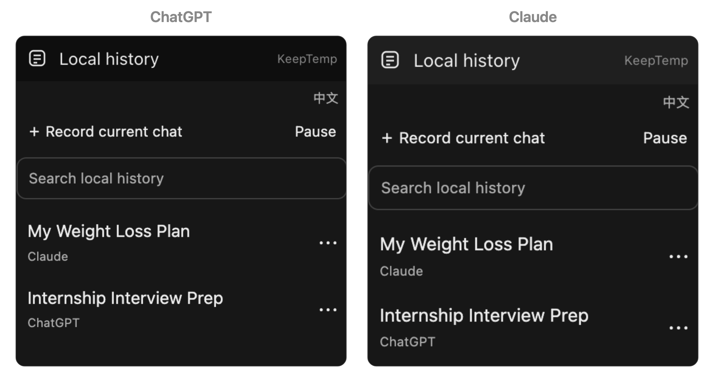
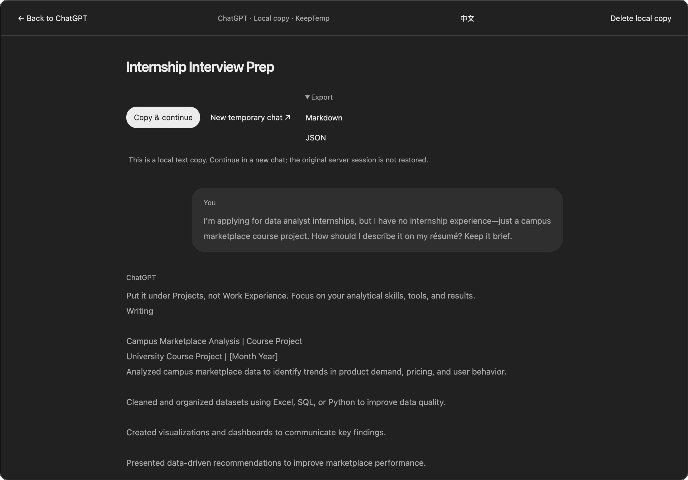

# KeepTemp

**有些问题，只想问 AI，不想让合购的人看到。**

和别人合购 ChatGPT、Claude，订阅费分摊了，聊天历史却也混在一起。工作上的难题、私人的烦恼，甚至一个不好意思让别人知道自己不懂的基础问题，都可能被同账号的人翻到。

于是你打开临时／隐身聊天。可聊出了一个好方案、理清了一件重要的事，又舍不得关掉：这段对话一旦丢了，下次还得从头解释。

**你想避免别人翻到自己的聊天，也想给自己留一份。**

KeepTemp 就是为这个矛盾做的简单浏览器插件：你照常在 AI 网页里用临时聊天，它把可读取的对话文字保存在自己的浏览器里。需要时找回来，一次复制到新聊天里接着聊，不用一轮轮搬进记事本。

**把有用的对话留在本机。** 在 ChatGPT 中整理实习面试思路，KeepTemp 持续保存可读取的文字。

[](docs/save-chat.png)

截图来自实际网页，使用虚构的学生经历演示；点击图片可查看原图。

## 它能帮你做什么

- **留住对话**：开启临时自动记录，或在已经聊到一半的页面点一次「记录当前对话」。后续回复继续更新，不需要反复手动保存。
- **找回进展**：在侧栏搜索、查看和管理已存会话，关掉聊天标签页后仍能打开。需要备份时导出 Markdown 或 JSON。
- **接着聊**：「复制并接续」包含完整的用户／AI 对话和接续提示词。粘贴到一个新聊天，让 AI 沿着已有背景继续；也可以从 ChatGPT 换到 Claude 等其他 AI。

不需要注册、API Key 或后端服务。聊天记录不上传到 KeepTemp 的服务器，没有云同步或第三方分析。

这个出发点也有研究依据：[CHI 2026 的共享 LLM 账号研究](https://arxiv.org/html/2603.22822v1#S4.SS4.SSS2)记录到，担心提问被他人看到，会让用户回避敏感话题、调整措辞或删除历史。

## 怎么用

1. 首次打开扩展，同意本地保存说明。
2. 在聊天标签页点击浏览器工具栏的 KeepTemp，再点 **记录当前对话**。新网站首次可能需要授予浏览器网站访问权限。
3. 看到 **Saved**，表示当次读取到的文字已写入本地数据库；后续消息会持续更新。
4. 下次从会话库打开记录，点 **复制并接续**，在目标 AI 的新聊天中粘贴并发送。

**换个 AI，背景不用重新解释。** 从 KeepTemp 复制 ChatGPT 的记录，粘贴到 Claude；它接着已有的项目经历与实际分工，继续准备面试追问。

[](docs/continue-chat.png)

每条会话旁的「⋯」可重命名或删除；网页上的状态菜单可暂停记录。普通对话也能主动保存。网站是否保留历史，仍由网站的聊天模式决定。

## 支持范围与边界

支持桌面 Chrome（116+）、Microsoft Edge 和 Brave，使用同一份扩展包。Edge 和 Brave 已通过合成对话的浏览器回归测试，详细环境见 [开发与测试](docs/development.md)。Firefox、Safari 和手机浏览器暂未适配。

提供 ChatGPT 适配，以及 Claude、Grok、Gemini、DeepSeek 和通用网页的实验适配。网页结构不同，**不能保证任意 AI 网站都能保存**；无法可靠识别消息时会报错。这些实验适配经过合成页面测试，尚未完成真实账号的全面验证。

请先在网站开启临时／隐身模式。KeepTemp 不会替你开启，也不会隐藏或删除已有的普通聊天历史；平台端保留规则不因本地保存改变。

插件保存网页可读取的文字，不恢复原服务端会话、附件或工具状态；接续效果取决于目标模型及其上下文容量。

本地数据库没有应用层加密，同一浏览器配置的使用者可能访问记录。重要内容请按需导出备份。详见 [隐私与安全边界](PRIVACY.md)。

## 本地安装

需要 Node.js 22.12+。在项目目录运行：

```sh
npm ci
npm run build
```

打开浏览器的扩展管理页：Chrome 为 `chrome://extensions`，Edge 为 `edge://extensions`，Brave 为 `brave://extensions`。开启「开发者模式」，选择加载已解压的扩展，加载项目下的 `.output/chrome-mv3` 文件夹。

该文件夹在构建后生成；如果看不到，请在文件选择器中显示隐藏文件，或输入该文件夹的完整路径。

## 参与开发

WXT + TypeScript + React + IndexedDB。欢迎改进页面适配、保存可靠性和简单好用的交互；提交问题时请勿附带私人聊天内容。

[架构](docs/architecture.md) · [开发与测试](docs/development.md) · [可行性与平台限制](docs/feasibility.md)

代码采用 [MIT License](LICENSE)。平台采集及扩展发布的许可仍需单独确认，开源代码许可不代表平台授权。
