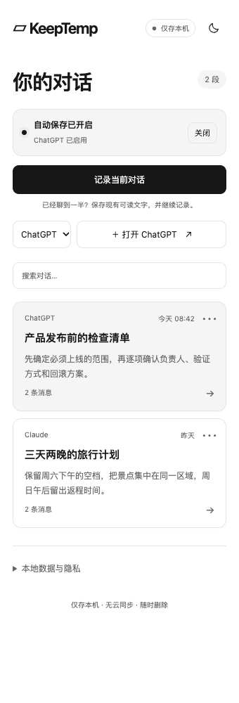
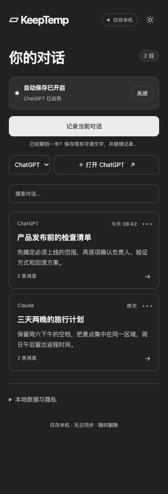

# KeepTemp

**临时聊天可以关掉，聊过的内容不用丢。**

和 AI 聊了二十轮，背景终于讲清楚、方案也快定了。结果临时聊天一关，下一次又得从头解释。

你想留住这些进展，却不想为了保存它们，把临时对话变成账号里的普通聊天历史。

KeepTemp 是一个 Chrome 扩展：把对话文字保存在本机，需要时找回来，一次复制到新聊天里接着聊。你继续用原来的 AI 网页，不用换聊天工具，也不用一轮轮复制到记事本。

## 它能帮你做什么

- **留住对话**：开启临时自动记录，或在已经聊到一半的页面点一次「记录当前对话」。后续回复继续更新，不需要反复手动保存。
- **找回进展**：在侧栏搜索、查看和管理已存会话，关掉聊天标签页后仍能打开。需要备份时导出 Markdown 或 JSON。
- **接着聊**：「复制并接续」包含完整的用户／AI 对话和接续提示词。粘贴到一个新聊天，让 AI 沿着已有背景继续；也可以从 ChatGPT 换到 Claude 等其他 AI。

不需要注册、API Key 或后端服务。聊天记录不上传到 KeepTemp 的服务器，没有云同步或第三方分析。

<p>
  
  
</p>

界面示例使用合成对话。

## 怎么用

1. 首次打开扩展，同意本地保存说明。
2. 在聊天标签页点击 Chrome 工具栏的 KeepTemp，再点 **记录当前对话**。新网站首次可能需要授予 Chrome 网站访问权限。
3. 看到 **Saved**，表示当次读取到的文字已写入本地数据库；后续消息会持续更新。
4. 下次从会话库打开记录，点 **复制并接续**，在目标 AI 的新聊天中粘贴并发送。

每条会话旁的「⋯」可重命名或删除；网页上的状态菜单可暂停记录。普通对话也能主动保存。网站是否保留历史，仍由网站的聊天模式决定。

## 支持范围与边界

面向桌面 Chrome 116+。提供 ChatGPT 适配，以及 Claude、Grok、Gemini、DeepSeek 和通用网页的实验适配。网页结构不同，**不能保证任意 AI 网站都能保存**；无法可靠识别消息时会报错。这些实验适配经过合成页面测试，尚未完成真实账号的全面验证。

KeepTemp 保存网页可读取的文字，不恢复原服务端会话、附件或工具状态；接续效果取决于目标模型及其上下文容量。本地副本不改变平台历史和保留规则，也不为共享账号提供隐私隔离。

本地数据库没有应用层加密，同一浏览器配置的使用者可能访问记录。重要内容请按需导出备份。详见 [隐私与安全边界](PRIVACY.md)。

## 本地安装

需要 Node.js 22.12+。在项目目录运行：

```sh
npm ci
npm run build
```

打开 `chrome://extensions`，开启「开发者模式」，选择「加载已解压的扩展程序」，加载项目下的 `.output/chrome-mv3` 文件夹。macOS 文件选择器可用 `Cmd + Shift + G` 输入该文件夹的完整路径。

## 参与开发

WXT + TypeScript + React + IndexedDB。欢迎改进页面适配、保存可靠性和简单好用的交互；提交问题时请勿附带私人聊天内容。

[架构](docs/architecture.md) · [开发与测试](docs/development.md) · [可行性与平台限制](docs/feasibility.md)

代码采用 [MIT License](LICENSE)。平台采集及扩展发布的许可仍需单独确认，开源代码许可不代表平台授权。
