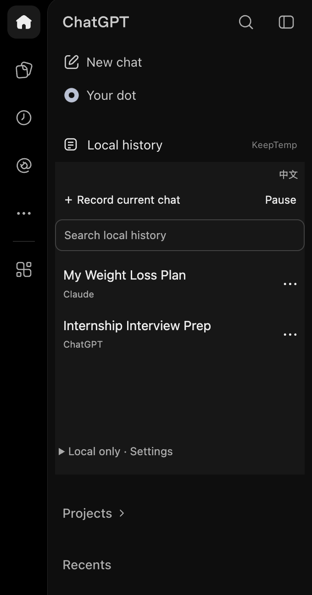
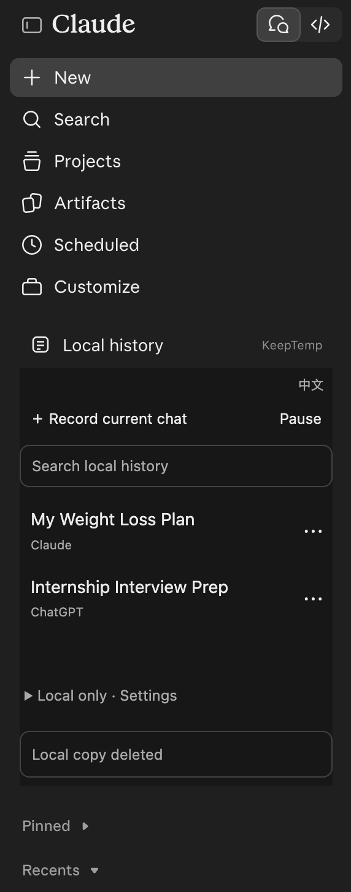
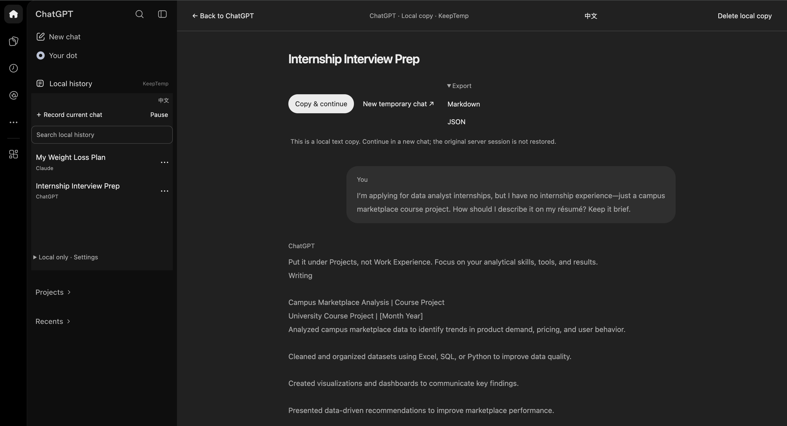

<div align="center">

# KeepTemp

[English](README.md) · **简体中文**

### 把 AI 临时对话保存为本机历史记录的浏览器扩展。

[**📥 下载安装包**](https://github.com/bennidict23/KeepTemp/releases/download/v0.9.0/keeptemp.zip) · [安装步骤](#安装)

</div>

和别人共享 ChatGPT、Claude，订阅费分摊了，聊天历史却也混在一起。工作上的难题、私人的烦恼，甚至一个不好意思让别人知道自己不懂的基础问题，都可能被同账号的人翻到。

于是你打开临时／隐身聊天。可聊出了一个好方案、理清了一件重要的事，又舍不得关掉：你不想把它留在共享历史里，也不想下次从头解释。

**KeepTemp 是为共享 AI 账号使用者做的本地会话库。** 启用记录后照常聊，它持续把可读取的对话文字保存在自己的浏览器里，不随共享账号同步。关掉页面后还能找回，想继续时带着已有背景接着聊。

<div align="center">

<a href="docs/chatgpt-sidebar.png"></a> &nbsp; <a href="docs/claude-sidebar.png"></a>

<sub>直接融入 ChatGPT 和 Claude 原有侧栏。保留原始截图，使用虚构对话演示。点击图片可查看原图。</sub>

</div>

- **💾 持续保存。** 临时聊天也能留下记录，后续消息持续更新。聊到一半才开始保存也可以，已经存好的内容关掉标签页后仍能找回。
- **🔎 随时找回。** ChatGPT 和 Claude 共用一份本机会话库，保留来源标签，支持全文搜索。通过 **⋯** 重命名或删除，也能导出 Markdown／JSON。
- **🔁 复制接续。** 一次复制完整记录与接续提示词，粘贴到新聊天。可以继续用原来的 AI，也可以换到另一个平台，省去重新解释背景的过程；由你决定在哪里粘贴和发送。

侧栏集成从 ChatGPT 和 Claude 开始。后续有时间会逐步适配 Gemini、Grok、DeepSeek 等平台，共用同一份本机历史。

<div align="center">

<a href="docs/local-history.png"></a>

<sub>在 ChatGPT 界面里打开已保存的对话，复制背景，接着聊。</sub>

</div>

无需注册 KeepTemp 或填写 API Key，不上传对话，无云同步或第三方统计。

## 安装

Chrome 116+ · Edge · Brave

1. [下载安装包](https://github.com/bennidict23/KeepTemp/releases/download/v0.9.0/keeptemp.zip)并解压。
2. 打开 `chrome://extensions`、`edge://extensions` 或 `brave://extensions`。
3. 开启 **开发者模式** → **加载已解压的扩展** → 选择解压后包含 `manifest.json` 的文件夹。

**开始使用：** 在网站开启临时／隐身模式，打开 KeepTemp，点击 **Record current chat**。看到 `Saved`，表示当次读取到的文字已存入本机。

<sub>插件不会隐藏或删除网站历史，本地数据库未加密。[隐私与使用边界](PRIVACY.md)</sub>

<details>
<summary>⚙️ 从源码构建</summary>

需要 Node.js 22.12+。在项目目录运行：

```sh
npm ci
npm run build
```

加载项目下的 `.output/chrome-mv3` 文件夹；文件选择器中看不到时，请显示隐藏文件夹。

[开发与测试](docs/development.md) · [架构](docs/architecture.md) · [平台限制](docs/feasibility.md)

</details>

[预览版与已知限制](docs/development.md#测试方法与边界) · [MIT License](LICENSE)
